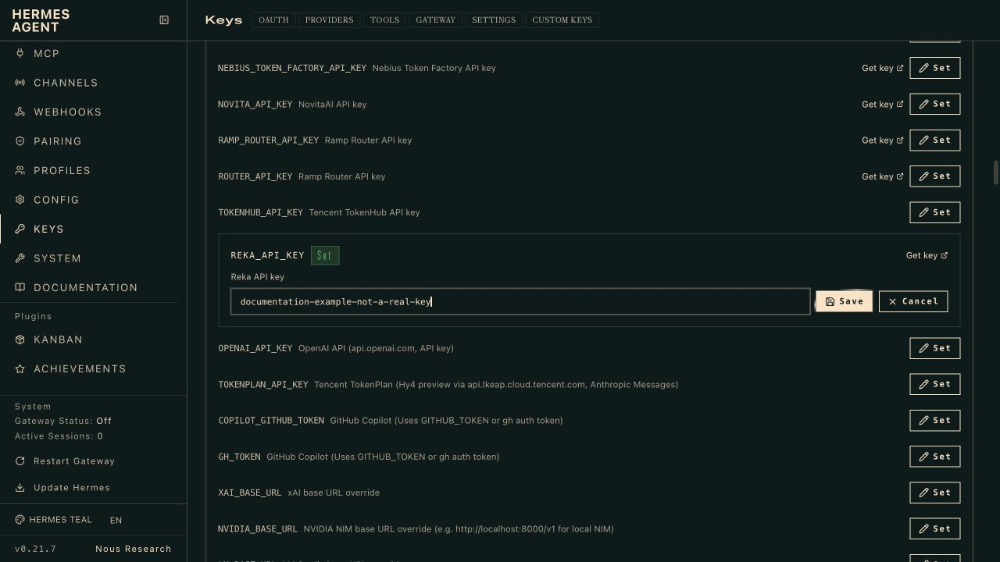
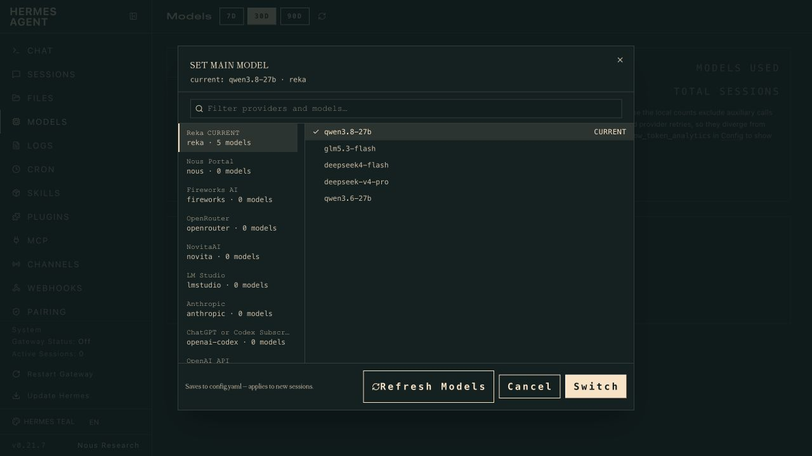
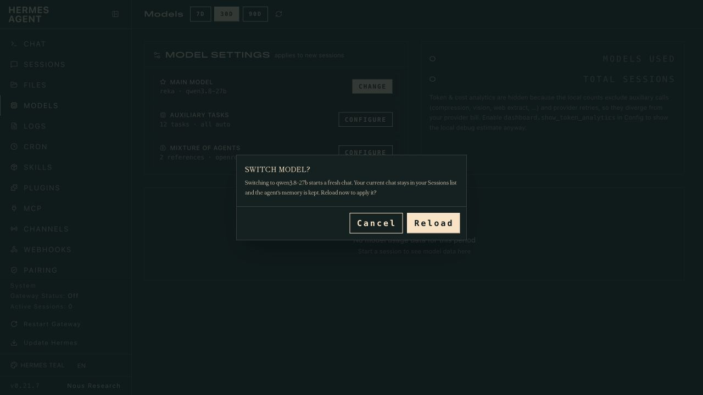
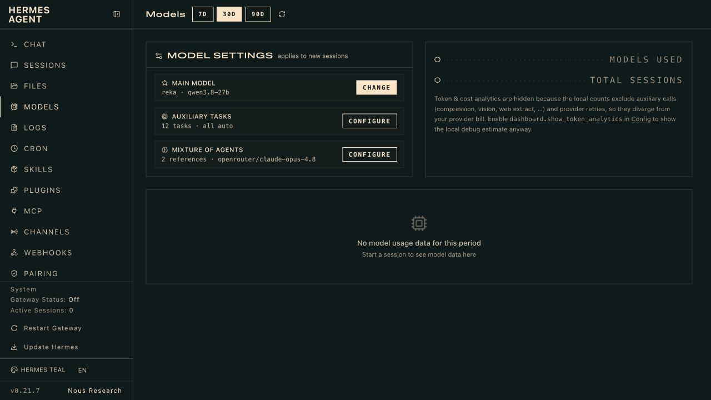

# Connect Hermes to Reka

Install the Reka provider, add your API key, and select **qwen3.8-27b**. Hermes
then sends your conversations directly to Reka at `https://api.reka.ai/v1`.
You do not need an OpenRouter account or a separate Reka software development
kit (SDK).

You need **Hermes 0.21.6 or later** and an API key from
[Reka's developer portal](https://developer.reka.ai).

The screenshots show Hermes v0.21.7. The key visible in them is a dummy example.

## 1 Install the provider

Use the same profile for installation, key entry, and chat. To keep a separate
profile, create it first with `hermes profile create reka-demo --no-alias`, then
use `hermes -p reka-demo` in place of `hermes` throughout this guide.

```sh
hermes plugins install "https://github.com/reka-ai/reka-hermes#reka-provider" --enable
```

To pin an exact version, add `--ref` followed by a full 40-character commit SHA
from this repository. If the installer asks for `REKA_API_KEY`, paste your key
(the prompt hides it) or press **Enter** to configure it in the next step.

The plugin has no additional runtime dependencies. Confirm it is enabled with:

```sh
hermes plugins list
```

## 2 Connect using the terminal or dashboard

### Terminal setup

```sh
hermes model
```

Select **Reka**, enter your key in the masked prompt, and press **Enter** to keep
`https://api.reka.ai/v1`. Choose **qwen3.8-27b**, then a reasoning effort: how
much the model thinks before it answers. Higher levels can help with harder
tasks but reply more slowly and use more tokens; **Disable reasoning** is the
fastest. Hermes saves the settings for the active profile.

You can now run `hermes chat`. If you prefer the browser controls, follow the
screenshots below instead of running the model wizard.

### Dashboard route with screenshots

Open the dashboard:

```sh
hermes dashboard
```

In **Keys**, enable **Show Advanced** if needed, select **Providers**, and expand
**Other**. Find `REKA_API_KEY`, click **Set** (or **Replace**), paste your own key,
then click **Save**. The field displays text while editing, so enter a real key
privately. Do not copy the dummy value shown here. Leave `REKA_BASE_URL` unset
to use the default endpoint.

[](images/quickstart/01-api-key.jpg)

## 3 Select Reka and Qwen

Open **Models**, then click **Change** beside **Main model**. Find **Reka** in
the provider list and select **qwen3.8-27b**. You can type `reka` in the search
field to narrow the list. Click **Switch**.

[](images/quickstart/02-select-reka-model.jpg)

Choose **Reload** in the confirmation dialog. Hermes applies the model to a fresh
chat; existing chats remain in **Sessions**.

[](images/quickstart/03-reload.jpg)

The **Main model** field should now read **reka · qwen3.8-27b**.

[](images/quickstart/04-model-saved.jpg)

## 4 Start a conversation

Open **Chat** and start a new conversation, or run:

```sh
hermes chat --provider reka -m qwen3.8-27b
```

A small first prompt is: **Reply with one sentence confirming you can read this
message.** Sending a prompt uses your Reka account and may incur charges.

For Qwen, the Chat reasoning control can request **Off (no thinking)**. This is
model-specific: do not assume every Reka model accepts the same reasoning levels.
After changing it, run `/new` or reload before sending a prompt.

## Updating

The plugin doesn't update itself. New Reka models and fixes arrive in plugin
updates, so run these every few weeks:

```sh
hermes plugins update reka-provider
hermes model --refresh
```

The refresh clears model IDs that Hermes cached from an earlier version.

## If something does not work

| What you see | What to check |
|---|---|
| Reka is missing, or old models appear | Run `hermes plugins list` in the same profile as the dashboard. Reload Hermes, then use **Refresh Models** in the picker or `hermes model --refresh` to clear a stale model cache. |
| HTTP 401 or 403 | Check the profile's Reka key. A 403 can also mean insufficient balance. |
| HTTP 404 | Use a Reka model ID such as `qwen3.8-27b`, not an OpenRouter-style ID such as `qwen/qwen3.8-27b`. The model may also not be enabled for your account. |
| HTTP 429 | Wait before retrying; this means a rate or capacity limit. |

A saved key or a model in the picker does not prove your account can call that
model.
